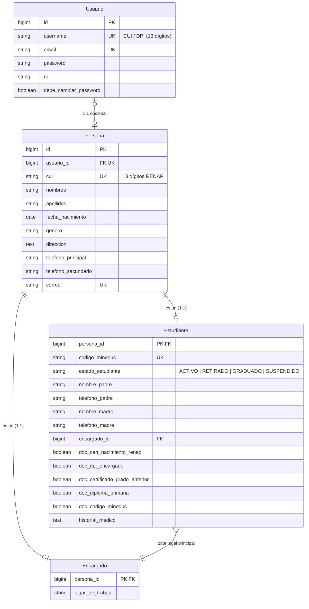

# 📘 Documentación de Lógica del Negocio y Relaciones de Base de Datos (v2.0)
## Sistema ERP Educativo — Instituto de Educación Básica "El Progreso" (Guatemala)

---

## 1. Introducción y Propósito del Documento

Este documento especifica la **Lógica de Negocio** y el **Modelo de Datos Relacional Refactorizado** del ERP Educativo para el **Instituto de Educación Básica "El Progreso"** (Guatemala), adaptado a la arquitectura de Django 6.0, PostgreSQL y el pensum oficial del **Ministerio de Educación de Guatemala (MINEDUC)** para el Nivel Medio (Ciclo Básico).

---

## 2. Principios Transversales de Arquitectura

### 2.1 Patrón Supertipo / Subtipo (Herencia de Persona)
El sistema centraliza los datos personales comunes en la tabla **`Persona`** (`APPS/core/models.py`). 
Los roles de la institución heredan de `Persona` mediante una relación $1:1$ (`OneToOneField`) actuando como Llave Primaria (`primary_key=True`):
- **`Estudiante`**: Subtipo de `Persona` (matrícula, código MINEDUC, estado estudiante, tutor legal FK, datos de padres, checklist de 5 documentos MINEDUC).
- **`Encargado`**: Subtipo de `Persona` (lugar de trabajo, tutor legal).
- **`Personal`**: Subtipo de `Persona` (puesto, NIT, fecha de contratación, estado laboral, salario base).

> 💡 *El campo `correo` en `Persona` es único y valida que no se duplique en la base de datos.*

### 2.2 Identificador de Usuario (CUI / DPI) y Login Multicriterio
- **`username` por Defecto:** En Estudiantes y Encargados, `username = CUI / DPI` (13 dígitos numéricos).
- **Autenticación Multicriterio (`CUIOrEmailModelBackend`):** El usuario puede iniciar sesión en la plataforma ingresando indistintamente:
  - Su **CUI / DPI** (13 dígitos).
  - Su **Correo Electrónico**.

### 2.3 Eliminación Lógica (*Soft Delete*)
Todos los modelos operativos heredan de la clase abstracta **`ModeloAuditable`**:
- `creado_en` (`DateTimeField`, `auto_now_add=True`)
- `actualizado_en` (`DateTimeField`, `auto_now=True`)
- `esta_eliminado` (`BooleanField`, `default=False`)
- **Custom Manager (`ActivosManager`)**: Filtra por defecto `esta_eliminado=False` en todas las consultas.

### 2.4 Integridad Referencial Estricta (`on_delete=models.RESTRICT`)
Todas las llaves foráneas (`ForeignKey` y `OneToOneField`) utilizan `on_delete=models.RESTRICT`, impidiendo eliminaciones en cascada y protegiendo la trazabilidad.

---

## 3. Lógica de Negocio del Módulo "Registro de Alumnos"

### 3.1 Expediente Digital 360° y Papelería MINEDUC
1. **Un solo Encargado Legal por Estudiante:** Cada estudiante posee un FK directo a `Encargado`. Se utiliza el buscador dinámico HTMX (`buscar_encargado_api`) para asociar tutores existentes a hermanos.
2. **Datos Informativos SIRE de Padres:** Se registran `nombre_padre`, `telefono_padre`, `nombre_madre`, `telefono_madre`.
3. **Checklist de 5 Documentos Obligatorios MINEDUC:**
   - `doc_cert_nacimiento_renap` (Certificado RENAP con CUI).
   - `doc_dpi_encargado` (Fotocopia DPI Encargado).
   - `doc_certificado_grado_anterior` (Certificado Grado Anterior).
   - `doc_diploma_primaria` (Diploma de Primaria).
   - `doc_codigo_mineduc` (Constancia Código MINEDUC).
4. **Estado de Expediente:** `@property expediente_completo` (5/5) e `@property documentos_entregados_count`.

### 3.2 Matriz de Validaciones de Negocio Activas (100% Cumplimiento)
- **CUI / DPI:** Exige 13 dígitos numéricos + unicidad en BD.
- **Email:** `clean_correo()` exige email único por persona.
- **Rango de Edad:** $10 \le \text{Edad} < 18$ años (Ciclo Básico diurno regular).
- **Teléfono Guatemala:** Exige exactamente 8 dígitos numéricos.
- **Tutor Legal Obligatorio:** Se exige asignación de un Encargado.

### 3.3 Generación de Documentación Oficial PDF (ReportLab)
- **Ficha de Expediente (PDF):** Expediente completo para el folder físico en Secretaría con firmas.
- **Comprobante de Credenciales (PDF):** Documento entregable con ambas cuentas (Estudiante y Tutor) y sus claves temporales.

---

## 4. Diagrama Entidad-Relación (Mermaid ERD)

