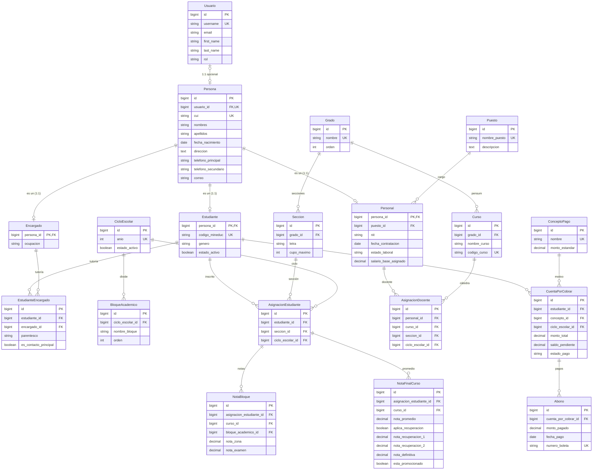

# 📘 Documentación de Lógica del Negocio y Relaciones de Base de Datos (Refactorizado v2.0)
## Sistema ERP Educativo — Instituto de Educación Básica "El Progreso" (Guatemala)

---

## 1. Introducción y Propósito del Documento

Este documento especifica la **Lógica de Negocio** y el **Modelo de Datos Relacional Refactorizado** del ERP Educativo para el **Instituto de Educación Básica "El Progreso"** (Guatemala), adaptado a la arquitectura de Django 6.0, PostgreSQL y el pensum oficial del **Ministerio de Educación de Guatemala (MINEDUC)**.

---

## 2. Principios Transversales de Arquitectura

### 2.1 Patrón Supertipo / Subtipo (Herencia de Persona)
El sistema centraliza los datos personales comunes en la tabla **`Persona`** (`APPS/core/models.py`). 
Los roles de la institución heredan de `Persona` mediante una relación $1:1$ (`OneToOneField`) actuando como Llave Primaria (`primary_key=True`):
- **`Estudiante`**: Subtipo de `Persona` (matrícula, código MINEDUC, género, estado activo).
- **`Encargado`**: Subtipo de `Persona` (ocupación, datos de tutor).
- **`Personal`**: Subtipo de `Persona` (puesto, NIT, fecha de contratación, estado laboral, salario base).

> 💡 *El campo `correo` en `Persona` almacena el email de contacto comercial/familiar, siendo totalmente independiente de las credenciales de acceso del usuario.*

### 2.2 Eliminación Lógica (*Soft Delete*)
Todos los modelos operativos heredan de la clase abstracta **`ModeloAuditable`**:
- `creado_en` (`DateTimeField`, `auto_now_add=True`): Creación automática.
- `actualizado_en` (`DateTimeField`, `auto_now=True`): Última modificación.
- `esta_eliminado` (`BooleanField`, `default=False`): Marca de borrado lógico.
- **Custom Manager (`ActivosManager`)**: Filtra por defecto `esta_eliminado=False` en todas las vistas y consultas regulares. Manager secundario `todos` para auditorías.

### 2.3 Integridad Referencial Estricta (`on_delete=models.RESTRICT`)
Todas las llaves foráneas (`ForeignKey` y `OneToOneField`) utilizan la cláusula `on_delete=models.RESTRICT`, impidiendo eliminaciones en cascada y protegiendo la trazabilidad legal y contable del centro educativo.

### 2.4 Auditoría de Cambios Inmutable (`django-simple-history`)
Se integra `django-simple-history` en los modelos críticos:
1. **`NotaBloque`**: Control e historial inmutable de modificaciones en notas de zona y examen.
2. **`Abono`**: Registro auditado de cada pago realizado a la cuenta corriente del alumno.
3. **`ArticuloInventario`**: Trazabilidad completa sobre los cambios de stock.

---

## 3. Lógica de Negocio por Subsistema

### 3.1 Subsistema Académico y Recuperaciones
1. **Nivel Básico (1ro, 2do y 3ro Básico)**: Pensum ajustado al MINEDUC de Guatemala.
2. **Evaluación de Bloque (100 Pts)**: Nota de Zona (máx. 60 pts) + Nota de Examen (máx. 40 pts). Aprobación $\ge 60.00$ pts.
3. **Control de Recuperaciones en `NotaFinalCurso`**:
   - `nota_promedio`: Promedio ordinario acumulativo de los bloques.
   - `aplica_recuperacion` (`BooleanField`): Se activa automáticamente si `nota_promedio < 60.00`.
   - `nota_recuperacion_1` y `nota_recuperacion_2`: Permite registrar hasta dos oportunidades de recuperación.
   - `nota_definitiva`: Punteo final tras considerar ordinarios y mejores notas de recuperación.
   - `esta_promocionado`: Bandera de aprobación si `nota_definitiva >= 60.00`.

### 3.2 Subsistema Financiero (Cuenta Corriente)
El módulo financiero se estructura bajo el patrón de **Cuenta Corriente**:
1. **`ConceptoPago`**: Catálogo de cuotas y aranceles (ej. Colegiatura mensual, Inscripción, Certificación).
2. **`CuentaPorCobrar`**: Deuda asignada a un estudiante por concepto y ciclo lectivo, con seguimiento de `monto_total`, `saldo_pendiente` y `estado_pago` (`PENDIENTE`, `PARCIAL`, `PAGADO`).
3. **`Abono`**: Transacciones de pago reales registradas contra la deuda, con número de boleta bancaria único y generación de comprobante en PDF.

---

## 4. Diagrama Entidad-Relación (Mermaid ERD)

