# 📐 Diagrama Entidad-Relación (ERD) — Base de Datos IBACOOP PROGRESO
## Sistema de Gestión Escolar / ERP Educativo (Instituto "El Progreso", Guatemala)

---

## 1. Diagrama ER Completo (Mermaid ERD)

```mermaid
erDiagram

    %% ------------------------------------------------------------------------
    %% AUTENTICACIÓN Y ENTIDAD BASE (SUPER TIPO / SUB TIPO)
    %% ------------------------------------------------------------------------
    Usuario {
        bigint id PK
        string username UK "CUI (13 dgs) / Email"
        string email
        string password
        string rol "ADMINISTRADOR | DIRECTOR | SECRETARIA | CONTADOR | DOCENTE | ESTUDIANTE | ENCARGADO | PERSONAL"
        boolean debe_cambiar_password
        boolean is_active
        boolean is_staff
        boolean is_superuser
    }

    Persona {
        bigint id PK
        bigint usuario_id FK,UK "OneToOne con Usuario (Opcional)"
        string cui UK "13 dígitos RENAP / DPI"
        string nombres
        string apellidos
        date fecha_nacimiento
        string genero "M | F"
        text direccion
        string telefono_principal
        string telefono_secundario
        string correo UK
        boolean esta_eliminado "Soft Delete"
    }

    %% ------------------------------------------------------------------------
    %% SUBTIPOS DE PERSONA
    %% ------------------------------------------------------------------------
    Estudiante {
        bigint persona_id PK,FK "OneToOne con Persona"
        string codigo_mineduc UK
        string estado_estudiante "ACTIVO | RETIRADO | GRADUADO | SUSPENDIDO"
        bigint encargado_id FK "Tutor Legal Principal"
        string nombre_padre
        string telefono_padre
        string nombre_madre
        string telefono_madre
        text historial_medico
        boolean doc_cert_nacimiento_renap
        boolean doc_dpi_encargado
        boolean doc_certificado_grado_anterior
        boolean doc_diploma_primaria
        boolean doc_codigo_mineduc
        boolean estado_activo
        boolean esta_eliminado "Soft Delete"
    }

    Encargado {
        bigint persona_id PK,FK "OneToOne con Persona"
        string lugar_de_trabajo
        boolean esta_eliminado "Soft Delete"
    }

    EstudianteEncargado {
        bigint id PK
        bigint estudiante_id FK
        bigint encargado_id FK
        string parentesco "PADRE | MADRE | ABUELO | TIO | HERMANO | TUTOR | OTRO"
        boolean es_contacto_principal
        boolean esta_eliminado "Soft Delete"
    }

    %% ------------------------------------------------------------------------
    %% RECURSOS HUMANOS (RRHH) Y PLANILLA
    %% ------------------------------------------------------------------------
    Puesto {
        bigint id PK
        string nombre_puesto UK
        text descripcion
        boolean esta_eliminado "Soft Delete"
    }

    Personal {
        bigint persona_id PK,FK "OneToOne con Persona"
        bigint puesto_id FK
        string nit
        date fecha_contratacion
        string estado_laboral "ACTIVO | BAJA | RETIRADO | SUSPENDIDO"
        decimal salario_base_asignado
        string numero_contrato_fisico
        string ubicacion_expediente_fisico
        string contacto_emergencia_nombre
        string contacto_emergencia_telefono
        boolean doc_dpi_personal
        boolean doc_nit_sat
        boolean doc_titulo_academico
        boolean doc_colegiado_activo
        boolean doc_antecedentes_penales
        boolean doc_antecedentes_policiales
        boolean doc_contrato_fisico
        boolean doc_tarjeta_salud
        boolean esta_eliminado "Soft Delete"
    }

    AsistenciaPersonal {
        bigint id PK
        bigint personal_id FK
        date fecha
        time hora_entrada
        time hora_salida
        string estado_asistencia "PRESENTE | AUSENTE | TARDANZA | PERMISO | VACACIONES"
        text observaciones
        boolean esta_eliminado "Soft Delete"
    }

    Planilla {
        bigint id PK
        bigint personal_id FK
        bigint ciclo_escolar_id FK
        int mes_pagado "1..12"
        decimal bonificaciones
        decimal descuentos
        decimal total_pagar
        string comprobante_pdf
        date fecha_pago
        boolean pagado
        boolean esta_eliminado "Soft Delete"
    }

    %% ------------------------------------------------------------------------
    %% SUBSISTEMA ACADÉMICO
    %% ------------------------------------------------------------------------
    CicloEscolar {
        bigint id PK
        int anio UK
        boolean estado_activo
        date fecha_inicio
        date fecha_fin
        boolean esta_eliminado "Soft Delete"
    }

    BloqueAcademico {
        bigint id PK
        bigint ciclo_escolar_id FK
        string nombre_bloque
        int orden
        date fecha_inicio
        date fecha_fin
        boolean esta_eliminado "Soft Delete"
    }

    Grado {
        bigint id PK
        string nombre UK "1ro Básico, 2do Básico, etc."
        int orden
        boolean esta_eliminado "Soft Delete"
    }

    Seccion {
        bigint id PK
        bigint grado_id FK
        string letra "A, B, C..."
        int cupo_maximo
        boolean esta_eliminado "Soft Delete"
    }

    Curso {
        bigint id PK
        bigint grado_id FK
        string nombre_curso
        string codigo_curso UK
        boolean esta_eliminado "Soft Delete"
    }

    AsignacionEstudiante {
        bigint id PK
        bigint estudiante_id FK
        bigint seccion_id FK
        bigint ciclo_escolar_id FK
        boolean esta_eliminado "Soft Delete"
    }

    AsignacionDocente {
        bigint id PK
        bigint personal_id FK
        bigint curso_id FK
        bigint seccion_id FK
        bigint ciclo_escolar_id FK
        boolean esta_eliminado "Soft Delete"
    }

    NotaBloque {
        bigint id PK
        bigint asignacion_estudiante_id FK
        bigint curso_id FK
        bigint bloque_academico_id FK
        decimal nota_zona "0.00 - 60.00"
        decimal nota_examen "0.00 - 40.00"
        boolean esta_eliminado "Soft Delete"
    }

    NotaFinalCurso {
        bigint id PK
        bigint asignacion_estudiante_id FK
        bigint curso_id FK
        decimal nota_promedio
        boolean aplica_recuperacion
        decimal nota_recuperacion_1
        decimal nota_recuperacion_2
        decimal nota_definitiva
        boolean esta_promocionado
        boolean esta_eliminado "Soft Delete"
    }

    AsistenciaEstudiantil {
        bigint id PK
        bigint asignacion_estudiante_id FK
        bigint curso_id FK
        date fecha
        boolean presente
        boolean justificado
        text observaciones
        boolean esta_eliminado "Soft Delete"
    }

    %% ------------------------------------------------------------------------
    %% SUBSISTEMA FINANCIERO
    %% ------------------------------------------------------------------------
    ConceptoPago {
        bigint id PK
        string nombre UK
        decimal monto_estandar
        boolean esta_eliminado "Soft Delete"
    }

    CuentaPorCobrar {
        bigint id PK
        bigint estudiante_id FK
        bigint concepto_id FK
        bigint ciclo_escolar_id FK
        decimal monto_total
        decimal saldo_pendiente
        date fecha_limite_pago
        string estado_pago "PENDIENTE | PARCIAL | PAGADO"
        boolean esta_eliminado "Soft Delete"
    }

    Abono {
        bigint id PK
        bigint cuenta_por_cobrar_id FK
        decimal monto_pagado
        date fecha_pago
        string numero_boleta UK
        string recibo_pdf
        text observaciones
        boolean esta_eliminado "Soft Delete"
    }

    %% ------------------------------------------------------------------------
    %% CONTROL DE INVENTARIOS
    %% ------------------------------------------------------------------------
    ArticuloInventario {
        bigint id PK
        string codigo_unico UK
        string nombre
        text descripcion
        string categoria "PAPELERIA | TECNOLOGIA | MOBILIARIO..."
        int stock_actual
        int stock_minimo_alerta
        string unidad_medida
        boolean esta_eliminado "Soft Delete"
    }

    MovimientoInventario {
        bigint id PK
        bigint articulo_id FK
        bigint personal_responsable_id FK
        string tipo_movimiento "ENTRADA | SALIDA | ASIGNACION | DEVOLUCION | AJUSTE | BAJA"
        int cantidad
        datetime fecha
        text motivo
        string documento_referencia
        boolean esta_eliminado "Soft Delete"
    }

    %% ------------------------------------------------------------------------
    %% PORTAL WEB PÚBLICO
    %% ------------------------------------------------------------------------
    ContenidoWeb {
        bigint id PK
        string seccion "NOTICIAS | HISTORIA | GALERIA | OFERTA | COMUNICADOS | EVENTOS"
        string titulo
        text cuerpo
        string imagen_url
        string imagen_archivo
        datetime fecha_publicacion
        boolean publicado
        bigint autor_id FK
        boolean esta_eliminado "Soft Delete"
    }

    %% ------------------------------------------------------------------------
    %% RELACIONES ENTRE ENTIDADES
    %% ------------------------------------------------------------------------

    %% Herencia Supertipo/Subtipo Persona
    Usuario ||--o| Persona : "1:1 opcional (cuenta de sistema)"
    Persona ||--o| Estudiante : "1:1 herencia Persona (primary_key)"
    Persona ||--o| Encargado : "1:1 herencia Persona (primary_key)"
    Persona ||--o| Personal : "1:1 herencia Persona (primary_key)"

    %% Relaciones de Estudiante y Encargados
    Estudiante }|--|| Encargado : "tutor legal principal (FK)"
    Estudiante ||--o{ EstudianteEncargado : "asociaciones parentesco N:M"
    Encargado ||--o{ EstudianteEncargado : "asociaciones parentesco N:M"

    %% Relaciones de RRHH
    Puesto ||--o{ Personal : "puesto asignado (1:N)"
    Personal ||--o{ AsistenciaPersonal : "registro de asistencia (1:N)"
    Personal ||--o{ Planilla : "pagos de nómina (1:N)"
    CicloEscolar ||--o{ Planilla : "ciclo lectivo (1:N)"

    %% Relaciones de Estructura Académica
    CicloEscolar ||--o{ BloqueAcademico : "bloques del ciclo (1:N)"
    Grado ||--o{ Seccion : "secciones del grado (1:N)"
    Grado ||--o{ Curso : "cursos del pensum (1:N)"

    %% Relaciones de Asignaciones
    Estudiante ||--o{ AsignacionEstudiante : "inscripciones (1:N)"
    Seccion ||--o{ AsignacionEstudiante : "estudiantes en sección (1:N)"
    CicloEscolar ||--o{ AsignacionEstudiante : "inscripciones del ciclo (1:N)"

    Personal ||--o{ AsignacionDocente : "docentes asignados (1:N)"
    Curso ||--o{ AsignacionDocente : "cursos a impartir (1:N)"
    Seccion ||--o{ AsignacionDocente : "secciones a impartir (1:N)"
    CicloEscolar ||--o{ AsignacionDocente : "docencia en ciclo (1:N)"

    %% Evaluaciones y Calificaciones
    AsignacionEstudiante ||--o{ NotaBloque : "notas de bloque (1:N)"
    Curso ||--o{ NotaBloque : "calificación de curso (1:N)"
    BloqueAcademico ||--o{ NotaBloque : "evaluación de bloque (1:N)"

    AsignacionEstudiante ||--o{ NotaFinalCurso : "promedio final (1:N)"
    Curso ||--o{ NotaFinalCurso : "cierre de curso (1:N)"

    AsignacionEstudiante ||--o{ AsistenciaEstudiantil : "asistencia diaria (1:N)"
    Curso ||--o{ AsistenciaEstudiantil : "asistencia por curso (1:N)"

    %% Subsistema Financiero
    Estudiante ||--o{ CuentaPorCobrar : "deudas del estudiante (1:N)"
    ConceptoPago ||--o{ CuentaPorCobrar : "tipo de cobro (1:N)"
    CicloEscolar ||--o{ CuentaPorCobrar : "cobros del ciclo (1:N)"
    CuentaPorCobrar ||--o{ Abono : "abonos a la cuenta (1:N)"

    %% Subsistema de Inventario
    ArticuloInventario ||--o{ MovimientoInventario : "historial de movimientos (1:N)"
    Personal ||--o{ MovimientoInventario : "responsable del movimiento (1:N)"

    %% Portal Web
    Usuario ||--o{ ContenidoWeb : "autor de publicaciones (1:N)"

```

---

## 2. Descripción de Patrones de Diseño de Base de Datos Aplicados

### 2.1 Patrón Supertipo / Subtipo (Herencia de `Persona`)
- La tabla **`Persona`** es el Supertipo central que almacena la información personal común (CUI/DPI, nombres, apellidos, fecha de nacimiento, género, dirección, teléfonos y correo).
- Las tablas **`Estudiante`**, **`Encargado`** y **`Personal`** son Subtipos que extienden a `Persona` mediante una relación $1:1$ utilizando `persona_id` como **Llave Primaria y Llave Foránea a la vez** (`primary_key=True`).
- Esto evita la duplicidad de columnas de información personal y permite consultar cualquier individuo de la institución desde una única entidad.

### 2.2 Autenticación Centralizada (`Usuario`)
- La entidad **`Usuario`** (que extiende de `AbstractUser` de Django) se vincula $1:1$ opcionalmente con **`Persona`**.
- Permite el **login multicriterio** (ingresando indistintamente el CUI/DPI de 13 dígitos o el correo electrónico).
- Posee el flag `debe_cambiar_password` para forzar la actualización de clave en el primer acceso.

### 2.3 Eliminación Lógica (*Soft Delete*) e Integridad Referencial Estricta (`on_delete=models.RESTRICT`)
- Todos los modelos operativos heredan de **`ModeloAuditable`**, incorporando las columnas `creado_en`, `actualizado_en` y `esta_eliminado`.
- Todas las llaves foráneas utilizan `on_delete=models.RESTRICT`, evitando borrados en cascada no deseados. El método `delete()` personalizado del modelo base verifica mediante introspección que no existan dependencias activas antes de marcar `esta_eliminado = True`.

### 2.4 Trazabilidad de Auditoría Inmutable (`django-simple-history`)
- Los modelos críticos (`NotaBloque`, `Abono` y `ArticuloInventario`) cuentan con auditoría inmutable de cambios (`HistoricalRecords`), guardando la foto histórica de cada modificación, la fecha/hora y el usuario responsable.

---

## 3. Resumen por Módulos y Relaciones

| Módulo | Entidad Principal | Entidades Relacionadas | Tipo de Relación |
| :--- | :--- | :--- | :--- |
| **Core / Usuarios** | `Usuario`, `Persona` | `Estudiante`, `Encargado`, `Personal` | $1:1$ (Herencia Supertipo/Subtipo) |
| **Estudiantes** | `Estudiante` | `Encargado`, `EstudianteEncargado` | $1:N$ (Tutor Principal) y $N:M$ (Parentescos) |
| **RRHH** | `Personal` | `Puesto`, `AsistenciaPersonal`, `Planilla` | $1:N$ |
| **Académico** | `CicloEscolar`, `Grado`, `Seccion`, `Curso` | `AsignacionEstudiante`, `AsignacionDocente`, `NotaBloque`, `NotaFinalCurso`, `AsistenciaEstudiantil` | $1:N$ |
| **Financiero** | `CuentaPorCobrar` | `ConceptoPago`, `Estudiante`, `CicloEscolar`, `Abono` | $1:N$ |
| **Inventario** | `ArticuloInventario` | `MovimientoInventario`, `Personal` | $1:N$ |
| **Portal Web** | `ContenidoWeb` | `Usuario` | $1:N$ |

